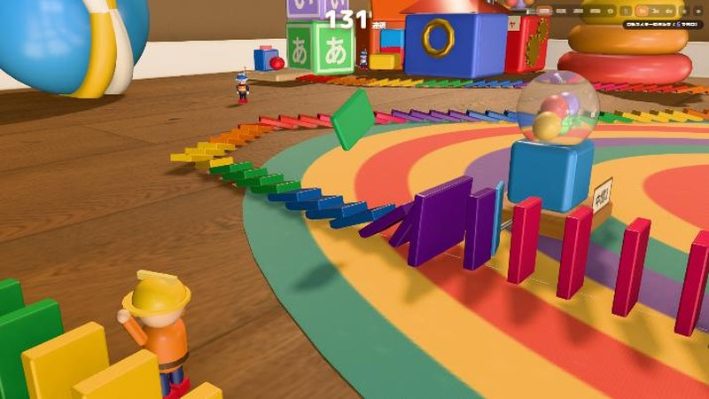

# 世界一長いドミノ倒し（Ver.0.5）

おもちゃが生きている部屋で、人（建設担当・運搬担当・回収担当・ストッパーズ）と一緒にドミノを並べ、**本物の物理演算で**世界一長いドミノ倒しに挑む 3D ブラウザゲームです。

**プレイ:** https://keda-commits.github.io/domino-world/
（以前の版はタグ `v0.1`〜`v0.3`・`v0.4.2` に保存しています）



## Ver.0.5 の主な変更

- 序盤：最初のガチャまでは「↺ 最初から並べ直す」（置いたドミノを全部資材箱へ戻す。セーブは消えない）。最初のガチャは回収担当を「おすすめ」
- ガチャは基本2択（10%で3択、四つ葉で確率アップ）。ぜんまい巻き戻しは廃止（候補不足のときは経験値パック）
- 人・ロボット・敵・設備をクリックするとカメラが追いかける。床のダブルクリックで接近。つかんでいる間は説明を出さない
- 音楽：クリアしなかった本番も明るい「よくできました」ジングル、クリアは大きなファンファーレ。建設中の事故には観客の「おぉ〜……あぁ〜……」
- 人はドミノの列を壁として迂回して歩く（グリッド経路探索）。どうしても道がないと列を「またぐ」（まれに1枚倒す）。**歩道橋**を置くと安全に越えられる。列車・資材箱もドミノを貫通しない
- 中間ゴールの幅広ドミノを廃止。通常のドミノが倒れると横のレバーが倒れて装置が動く
- ステージ1・2では**ドミノ自動設置機・高速建設ラインを休止**（並べるのは人の仕事。セーブのレベルは残る）
- ステージ1：レベル5から**いたずらロボット**、レベル7から**暴走ミニカー**。防衛は**おもちゃの兵隊**（スポンジ弾。つかんで置いた所が持ち場）と**バリケード**（ミニカーを跳ね返す）
- 復旧係：事故現場へ走り、マジックハンドで届く範囲を続けて起こす。人数を増やすと速くなる
- 部屋を約20%広げた（コースの枚数は同じ。壁ぎわに作業スペース）
- 工場はベルトコンベアでドミノ箱へ、運搬担当が取りに来る。かご・水平器・ブーツが見た目で分かる。獲得直後はその効果をカメラで見せる
- 手が空いた人は待機所で腕立て・ダンベル・ボール遊び・昼寝など。性格と役割で過ごし方が違い、役割のレベルが低いほどたまにサボる

## ゲームの流れ

基本は「**普段はドミノを触って遊ぶ。本番はドミノ倒しを見守る**」。

1. **手で並べる**：おもちゃ箱・前線の資材箱から**ドラッグでドミノを取り出し**、床の設計図（点線）のマスの上で**そっと離す**と立つ（緑の輪が控えめなガイド。離した後の自動補正はなし）。乱暴に落とすと倒れ、勢いよく離すと飛んでいく
2. **自動化**：連鎖で経験値（1枚 = 1XP）→ ガチャで建設担当・運搬・回収・機械を増やすと、建設が自動になる。獲得した人は自分の待機所へ歩いていく（建設隊 待機所・物流拠点・防災詰所・機械置き場・倉庫の棚）
3. **事故を止める**：人のうっかりや、いたずらネズミ（ステージ1の中盤から）でドミノが倒れ始めたら、**連鎖の先のドミノを1枚抜く**と止まる。ストッパーズを獲得すると自動でストッパーを置いてくれ、進化すると先回りして危険区間を隔離する
4. **本番**：「▶ 倒す！」で操作ロック。カメラが連鎖の先頭を低い位置から追う（中間ゴールでもカメラは動かない）。俯瞰との切り替えだけ可能
5. **中間ゴール**：通過型のおもちゃ装置。初めて動かしたときだけ確定ガチャ
6. **クリア**：スタートからの一本の連鎖が最終ゴール装置を動かす

| ステージ | 舞台 | 設計図 | 中間ゴール | 脅威 |
|---|---|---|---|---|
| 1 | 子ども部屋「はじめての大連鎖」（115×77） | 889枚 | 6 | うっかり事故・いたずらネズミ（中間ゴール2の後）・いたずらロボット（Lv5〜）・暴走ミニカー（Lv7〜） |
| 2 | リビング「ルンバが来たぞ！」 | 1,301枚 | 4 | ルンバ（予告→出発→掃除→帰還→充電）・いたずらネズミ（ソファの下）・転がるゴムボール |

※自由にコースを描く仕組み（描く・おすすめルート・高架橋・分岐など）はコードに残してあり、将来のエンドレスモードで使う予定です（通常ステージでは無効）。

## 操作

- **ドミノ**：ドラッグでつかむ（立っている・倒れている・倒れて固定された・下敷き・コース外・資材置き場）／離して置く・投げる／ダブルクリックでデコピン／重なっている所は Tab でつかむ1枚を切り替え
- **物をつかむ（共通の「つかめるオブジェクト」）**：カーソルを合わせて黄色い輪が出るものは、ドラッグで運んで離すと落ちる
  - 前線の資材箱（開始時にドミノ50個入り。中のドミノ＝1枚取り出す／縁・旗＝箱ごと運ぶ。運んだ場所に固定）
  - 小物：積み木・ぬいぐるみ・おもちゃの車・大きなボール・輪投げタワー・植木鉢・ゴムボール
  - 人（建設担当・運搬担当・回収担当・ストッパーズ・おもちゃの兵隊）：つかむと作業を中断し、離すと作業へ戻る（兵隊は離した所が持ち場）
  - 小型設備：ドミノ自動設置機・資材運搬トレイン・ドミノ製造機・欲張り貯金箱・配置したバリケード／ベル／センサー
  - いたずらネズミ・いたずらロボット（つかむと帰る）・暴走ミニカー（予告中につかむと車庫へ戻る）
  - つかめないもの：大型家具・壁・ラグ／カーペット、おもちゃ箱（倉庫）、ガチャマシン、中間ゴールと最終ゴールの装置、充電台、見張り塔・本部、ルンバ、設置済みのストッパー
  - つかんでいる間：ホイール＝高さ、Q / E＝向き、Shift＋ホイール＝傾き
- **カメラ**：左ドラッグ（何もない所）・WASD＝平行移動／右ドラッグ・Alt＋左ドラッグ＝回転／ホイール＝カーソル位置へズーム／空き場所をダブルクリック＝注目／Home＝建設現場へ
- 視点：建設（B）・観賞（V）・連鎖追跡（F）・俯瞰（O）。本番中は 追跡／俯瞰 の切り替えだけ
- 1〜4：道具（手・パーツ・試し倒し・ストッパー）／Enter：倒す／R（長押し）：片付け／P：一時停止
- カーソルを人・ドミノ・設備・ルンバ・ネズミに合わせると、ゲームデータの情報が出る（ホバーステータス）
- 設定：ルンバ・敵の音量を個別に調整できる
- デバッグメニュー：`` ` `` キー、または URL に `?debug=1`

## 開発

```bash
npm install
npm run dev       # http://localhost:5173
npm run build     # dist/（base は /domino-world/）
```

main への push で GitHub Actions が GitHub Pages に自動デプロイします。

### 構成

| パス | 役割 |
|---|---|
| `src/core/physics.js` | Rapier の初期化・固定タイムステップ |
| `src/core/dominoes.js` | 物理ドミノ（剛体・転倒検出・固定化・InstancedMesh 描画。描画モデルとコライダーは別） |
| `src/core/course.js` | コース（線→等間隔スロット、連鎖の順番と系統） |
| `src/world/stages.js` | ステージ定義（設計図・中間ゴール・家具・ルンバ巡回） |
| `src/world/checkpoints.js` | 中間ゴール装置（ドミノの傾きで倒れるレバー） |
| `src/world/assets.js` | 外部素材（Poly Haven / CC0）の読み込み |
| `src/world/props.js` | プロシージャルな家具・おもちゃ |
| `src/world/devices.js` / `goalMachine.js` | ゴール装置・ストッパー等 |
| `src/world/roomba.js` | ルンバ AI と見た目 |
| `src/actors/` | 人・ストッパーズのモデルと AI |
| `src/game/game.js` | ゲーム本体（建設・連鎖・失敗分析・中間ゴール・報酬・セーブ形式） |
| `src/game/progress.js` / `src/data/parts.js` | 経験値・ガチャ・パーツ・進化（**調整用設定ファイル**） |
| `src/render/renderer.js` | 描画（HDRI 環境光・PCF ソフトシャドウ・N8AO・SMAA・高画質のみブルーム/被写界深度） |
| `src/render/cameraRig.js` | カメラ（床をつかむ平行移動・回転・本番の追跡カメラと操作ロック） |
| `src/game/hand.js` | プレイヤーの手（つかむ・落とす・投げる・デコピン・人への当たり） |
| `src/ui/hover.js` | ホバーステータス |
| `src/world/threats.js` | いたずらネズミ・ゴムボール |
| `src/world/enemies.js` | いたずらロボット・暴走ミニカー（Ver.0.5） |
| `src/game/nav.js` | 経路探索（0.5マスのグリッド、ドミノの列・家具・歩道橋、A*） |
| `src/game/defense.js` | おもちゃの兵隊のスポンジ弾 |
| `src/audio/jingles.js` | 成功ジングル・クリアのファンファーレ・観客の声（WebAudio で合成。各2案） |
| `src/world/camps.js` | 獲得物の行き先（看板・倉庫の棚）とガチャの展示スペース |
| `src/render/gachaShow.js` | 3D ガチャ演出 |
| `src/audio/audio.js` | 効果音とオリジナル BGM（WebAudio で合成） |
| `src/ui/ui.js` | HUD・短い結果表示・記録・メニュー |
| `src/debug.js` | デバッグメニューと自動検証（`__dbg`、`botPlay` は通常と同じ関数で遊ぶ自動プレイヤー） |
| `src/legacy/challenge/` | 旧・連続運転モード（将来用に保存） |

### セーブ

- キー `domino-world-save-v3`（Ver.0.4 も同じキー。ステージ1の設計図が変わったため、古い配置は在庫に戻して中間ゴールの記録を新コース用に初期化。レベル・パーツ・記録はそのまま）。Ver.0.2 の `domino-world-save-v2` は**削除せず残し**、v3 が無いときだけ読み込んで移行します（レベル・パーツ・進化・未開封ガチャ・記録は引き継ぎ、置いてあったドミノは在庫に戻し、旧コースは新しい設計図に置き換え）
- Ver.0.5：部屋を広げたため、小物・工場の位置は Ver.0.5 の配置で保存したものだけ復元（古い位置は使わない）。自動設置機・センサー・巻き戻しのレベル／個数は残すが、ステージ1・2では出現・稼働しない
- 保存前に前回分を `-backup` に退避
- 保存対象：ステージ進行・レベル/経験値・パーツ・進化・未開封ガチャ・建設済みドミノ・配置パーツ・ストッパー・中間ゴール/特殊ドミノの受け取り状況・記録（履歴40件）・設定

## ライセンスと出典

`CREDITS.md` を参照してください。
