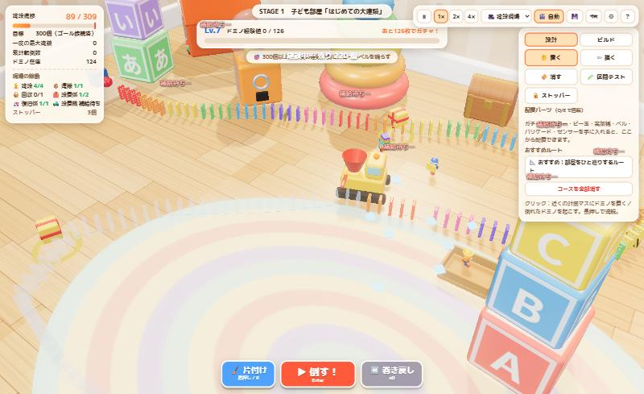

# 世界一長いドミノ倒し（Ver.0.2）

おもちゃが生きている部屋で、小人たちと一緒にドミノを並べ、**本物の物理演算で**世界一長いドミノ倒しに挑む 3D ブラウザゲームです。

**プレイ:** https://keda-commits.github.io/domino-world/
（Ver.0.1 はタグ `v0.1` に保存しています）



## ゲームの流れ

1. **コースを描く**：スタート（緑の輪）からゴール装置（ピンクの輪）まで、マウスでドラッグして線を引く。線に沿って等間隔にドミノのマスが並ぶ
2. **建設する**：手で置く／小人や自動設置機が自動で建てる。ドミノは在庫を使い、倒れたものは起こして・拾って再利用
3. **守る**：小人のうっかり事故やルンバから、ストッパーズとストッパーで守る
4. **倒す**：好きなときに「▶ 倒す！」。スタート台のパンチから Rapier の剛体物理で連鎖する
5. **経験値とガチャ**：倒れた枚数が経験値。レベルアップごとに 3 択ガチャでパーツを獲得（連鎖が終わってからまとめて開封）
6. **クリア**：目標数以上を一度の連鎖で倒し、最後のドミノがゴール装置を物理的に作動させたらクリア

| ステージ | 舞台 | 目標 | 難しさ |
|---|---|---|---|
| 1 | 子ども部屋「はじめての大連鎖」 | 300個以上 → ゴールベル | 大量に建設できるようになること |
| 2 | リビング「ルンバが来たぞ！」 | 1,000個以上 → 巨大からくり装置 | 建設したドミノを守りながらつなげること |

ステージ2をクリアすると「COMING SOON：巨大な犬」。

## 操作

- 左ドラッグ：回転（✏描くモードでは線を描く）／右ドラッグ：移動／ホイール：ズーム／WASD：移動
- 1〜5：ツール（置く・描く・消す・区間テスト・ストッパー）／Q・E：パーツ回転
- Enter：倒す／R（長押し）：片付け／C：カメラ切替／P：一時停止／H：遊び方
- デバッグメニュー：`` ` `` キー、または URL に `?debug=1`

## 開発

```bash
npm install
npm run dev       # http://localhost:5173
npm run build     # dist/（base は /domino-world/）
node tools/physics-probe.mjs   # 物理パラメータの検証（直線・カーブ・すき間・ストッパー・1500個）
node tools/uturn-probe.mjs     # Uターンでの連鎖成功率
```

main への push で GitHub Actions が GitHub Pages に自動デプロイします。

### 構成

| パス | 役割 |
|---|---|
| `src/core/physics.js` | Rapier の初期化・固定タイムステップ |
| `src/core/dominoes.js` | 物理ドミノ（剛体・転倒検出・固定化・InstancedMesh 描画） |
| `src/core/course.js` | コース計画（線→等間隔スロット、分岐、ピース接続、連鎖の順番と系統） |
| `src/world/stages.js` | ステージ定義（家具・障害物・おすすめルート・ルンバ巡回） |
| `src/world/props.js` | プロシージャルな家具・おもちゃ |
| `src/world/devices.js` / `goalMachine.js` | ゴール装置・ミニカー・ビー玉・高架橋・ストッパー等 |
| `src/world/roomba.js` | ルンバ AI |
| `src/actors/` | 小人・ストッパーズのモデルと AI |
| `src/game/game.js` | ゲーム本体（建設・連鎖・失敗分析・区間テスト・巻き戻し・報酬・セーブ形式） |
| `src/game/progress.js` / `src/data/parts.js` | 経験値・ガチャ・パーツ・進化（**調整用設定ファイル**） |
| `src/render/` | 描画（環境マップ・影・AO/ブルーム/被写界深度）・カメラ |
| `src/audio/audio.js` | 効果音とオリジナル BGM（WebAudio で合成） |
| `src/ui/ui.js` | HUD・ツール・結果・ガチャ演出 |
| `src/debug.js` | デバッグメニューと自動検証（`__dbg`） |
| `src/legacy/challenge/` | 旧・連続運転モード（将来のチャレンジモード用に保存） |

### セーブ

- キー `domino-world-save-v2`（Ver.0.1 の `domino-world-save-v1` は読み書きせず残します）
- 保存前に前回分を `-backup` に退避
- 保存対象：ステージ進行・レベル/経験値・パーツ・進化・未開封ガチャ・巻き戻し所持数・各ステージのコース（線）・建設済みドミノ（倒れたものは姿勢も）・配置ギミック・ストッパー（ロック状態）・宝箱/プレゼント/ガチャマシンの使用状況・自己ベスト・設定

## ライセンスと出典

`CREDITS.md` を参照してください。
