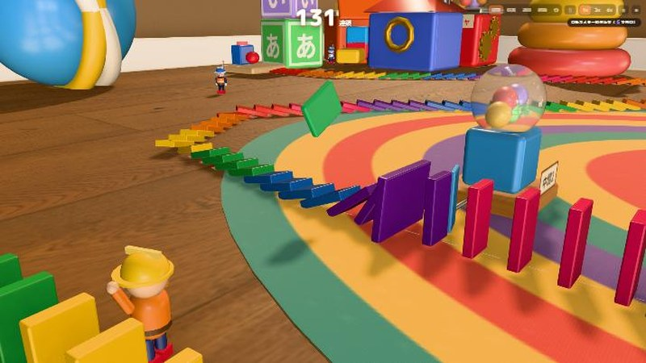

# 世界一長いドミノ倒し（Ver.0.3）

おもちゃが生きている部屋で、人（建設担当・運搬担当・回収担当・ストッパーズ）と一緒にドミノを並べ、**本物の物理演算で**世界一長いドミノ倒しに挑む 3D ブラウザゲームです。

**プレイ:** https://keda-commits.github.io/domino-world/
（Ver.0.1 はタグ `v0.1`、Ver.0.2 はタグ `v0.2` に保存しています）



## ゲームの流れ（Ver.0.3）

1. **設計図に沿って並べる**：コースは各ステージで用意された設計図（床の点線ガイド）。クリックで先頭に1個、長押しで連続。人や機械がガチャで増えると自動で建設
2. **倒す**：いつでも「▶ 倒す！」（確認ダイアログなし。未建設・倒れたドミノがあれば小さく警告）
3. **経験値**：倒れた **1枚 = 1XP**。上のゲージに「あとN枚でガチャ」
4. **中間ゴール**：連鎖が通過型のおもちゃ装置（ベル・旗・ガチャレバー・警報ベル）を物理的に作動させると、**確定ガチャ（各中間ゴールで一度きり）**。ステージ1に3か所、ステージ2に4か所
5. **ガチャ**：連鎖の結果を短く表示したあと、部屋の中のガチャマシンへカメラが移動。カプセル → 3つのおもちゃパッケージ（3Dプレビュー付き）から1つ選ぶと、開封されて中身が実際にワールドへ登場
6. **クリア**：スタートからの一本の連鎖が最終ゴール装置を動かしたらクリア（枚数は条件ではありません。ルンバなどで起きた別の連鎖は数えません）

| ステージ | 舞台 | 設計図 | 中間ゴール | 最終ゴール |
|---|---|---|---|---|
| 1 | 子ども部屋「はじめての大連鎖」 | 309枚 | 3（ベル・ガチャレバー・旗） | ゴールベル |
| 2 | リビング「ルンバが来たぞ！」 | 1,301枚 | 4（旗・警報ベル・防衛ガチャ・第2警報ベル） | 巨大からくり装置 |

ステージ2では巡回するロボット掃除機（ルンバ）が列を壊します。バリケード・特殊ベル・見張り塔・復旧係・警報ベルの中間ゴール（ルンバを充電台へ帰らせる）で守りながらつなげます。

※自由にコースを描く仕組み（描く・おすすめルート・高架橋・分岐など）はコードに残してあり、将来のエンドレスモードで使う予定です（通常ステージでは無効）。

## 操作

- 左ドラッグ：回転／右ドラッグ：移動／ホイール：カーソル位置へズーム／WASD：移動／ダブルクリック：そこへ注目
- 短いクリック：ドミノを置く（ドラッグは回転）／長押し：連続で置く
- 視点：建設（B）・観賞（V）・連鎖追跡（F）・俯瞰（O）・リセット（Home）／🎬：連鎖中の自動カメラ ON/OFF（手で動かすとその回は止まる）
- 1〜4：道具（置く・パーツ・試し倒し・ストッパー）／Q・E：パーツ回転
- Enter：倒す／R（長押し）：片付け／P：一時停止
- ガチャ中：1〜3 で選択／Space でスキップ／早送りボタン
- デバッグメニュー：`` ` `` キー、または URL に `?debug=1`

## 開発

```bash
npm install
npm run dev       # http://localhost:5173
npm run build     # dist/（base は /domino-world/）
```

main への push で GitHub Actions が GitHub Pages に自動デプロイします。

### 構成

| パス | 役割 |
|---|---|
| `src/core/physics.js` | Rapier の初期化・固定タイムステップ |
| `src/core/dominoes.js` | 物理ドミノ（剛体・転倒検出・固定化・InstancedMesh 描画。描画モデルとコライダーは別） |
| `src/core/course.js` | コース（線→等間隔スロット、連鎖の順番と系統） |
| `src/world/stages.js` | ステージ定義（設計図・中間ゴール・家具・ルンバ巡回） |
| `src/world/checkpoints.js` | 中間ゴール装置（幅広ドミノ＋回転ジョイントのスイッチ板） |
| `src/world/assets.js` | 外部素材（Poly Haven / CC0）の読み込み |
| `src/world/props.js` | プロシージャルな家具・おもちゃ |
| `src/world/devices.js` / `goalMachine.js` | ゴール装置・ストッパー等 |
| `src/world/roomba.js` | ルンバ AI と見た目 |
| `src/actors/` | 人・ストッパーズのモデルと AI |
| `src/game/game.js` | ゲーム本体（建設・連鎖・失敗分析・中間ゴール・報酬・セーブ形式） |
| `src/game/progress.js` / `src/data/parts.js` | 経験値・ガチャ・パーツ・進化（**調整用設定ファイル**） |
| `src/render/renderer.js` | 描画（HDRI 環境光・PCF ソフトシャドウ・N8AO・SMAA・高画質のみブルーム/被写界深度） |
| `src/render/cameraRig.js` | カメラ（視点・自動カメラ・手動優先） |
| `src/render/gachaShow.js` | 3D ガチャ演出 |
| `src/audio/audio.js` | 効果音とオリジナル BGM（WebAudio で合成） |
| `src/ui/ui.js` | HUD・短い結果表示・記録・メニュー |
| `src/debug.js` | デバッグメニューと自動検証（`__dbg`、`botPlay` は通常と同じ関数で遊ぶ自動プレイヤー） |
| `src/legacy/challenge/` | 旧・連続運転モード（将来用に保存） |

### セーブ

- キー `domino-world-save-v3`。Ver.0.2 の `domino-world-save-v2` は**削除せず残し**、v3 が無いときだけ読み込んで移行します（レベル・パーツ・進化・未開封ガチャ・記録は引き継ぎ、置いてあったドミノは在庫に戻し、旧コースは新しい設計図に置き換え）
- 保存前に前回分を `-backup` に退避
- 保存対象：ステージ進行・レベル/経験値・パーツ・進化・未開封ガチャ・建設済みドミノ・配置パーツ・ストッパー・中間ゴール/特殊ドミノの受け取り状況・記録（履歴40件）・設定

## ライセンスと出典

`CREDITS.md` を参照してください。
